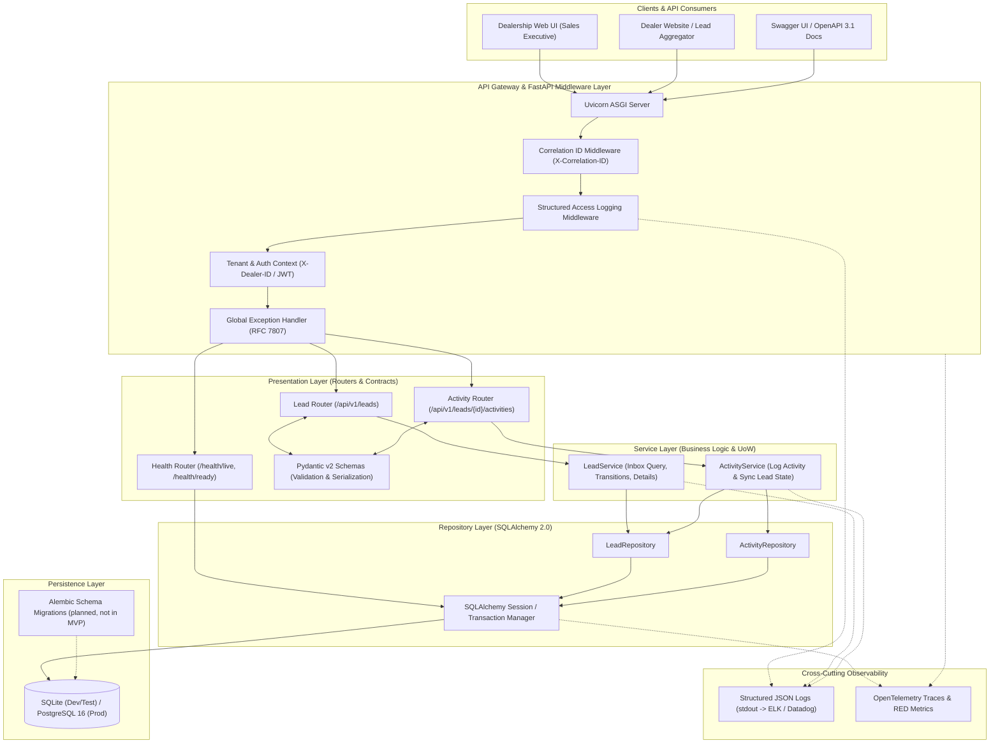
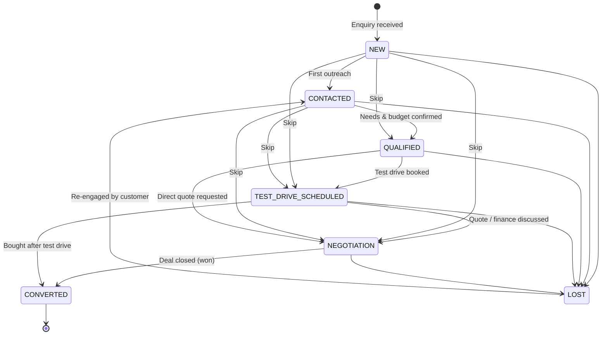
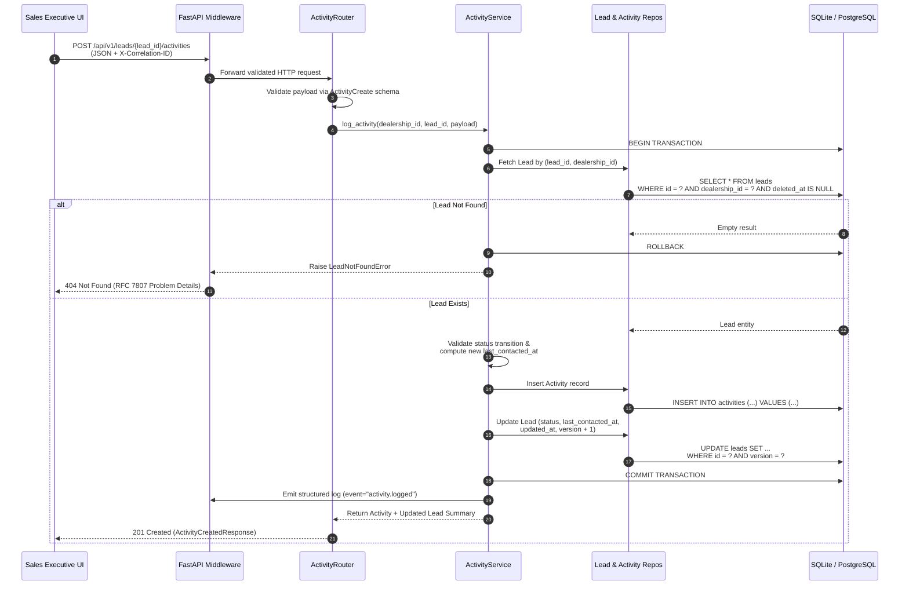
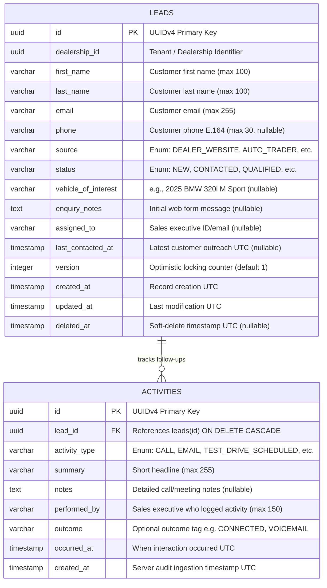

# System Design Document: Sales Lead Management Tool (Demand Domain)

| Metadata | Details |
| :--- | :--- |
| **Document Title** | Sales Lead Management Tool — Backend System Design |
| **Target Context** | Keyloop Engineering Manager Technical Assessment — Scenario C (Domain: Demand) |
| **Version** | 1.0.0 |
| **Status** | Architecture Proposal & Implementation Blueprint |
| **Core Stack** | Python 3.12+, FastAPI, SQLAlchemy 2.0, Pydantic v2, SQLite (Dev/Test) / PostgreSQL 16 (Prod), Pytest |

---

## Executive Summary

In automotive retail, **speed-to-lead** and disciplined follow-up execution directly govern dealership conversion rates and customer satisfaction. This document specifies the backend architecture for **Scenario C: The Sales Lead Management Tool** within the **Demand** domain. The system provides dealership sales executives with a reliable, low-latency REST API to triage incoming website leads (**Lead Inbox**), inspect a complete customer engagement history (**Lead Details View**), and record follow-up interactions (**Activity Logging**) with strict transactional consistency.

To balance rapid delivery for the assessment MVP with enterprise readiness for Keyloop's multi-dealership automotive ecosystem, the system adopts a **Layered Modular Monolith** architecture with strict domain boundaries, RFC 7807 standardized error contracts, structured observability, and a clear horizontal scaling roadmap.

---

## 1. Architecture Overview

### 1.1 Architectural Style: Layered Modular Monolith

Rather than introducing premature microservice complexity, the backend is designed as a **Layered Modular Monolith** following Dependency Inversion principles:

- **Clear Separation of Concerns**: HTTP transport (Routers/Schemas), business orchestration (Services), and persistence mechanics (Repositories/ORM) are isolated into distinct layers.
- **Strong ACID Consistency**: Recording an activity and updating the parent lead's `last_contacted_at` timestamp and lifecycle status execute atomically within a single database transaction.
- **Future Extractability**: Because business logic is decoupled from both FastAPI and raw SQL, domain modules (e.g., `leads`, `activities`, future `notifications`) can be extracted into independent services or event-driven consumers without rewriting core domain rules.

### 1.2 System Architecture Diagram



---

## 2. Key Assumptions & Design Decisions

Where the assessment brief intentionally leaves requirements open, the following pragmatic, automotive-domain-aligned assumptions have been established:

### 2.1 Lead Lifecycle & Status Progression
- **Defined Statuses**: `NEW`, `CONTACTED`, `QUALIFIED`, `TEST_DRIVE_SCHEDULED`, `NEGOTIATION`, `CONVERTED`, `LOST`.
- **Automatic Progression on Activity Logging**:
  - When a substantive customer interaction (`CALL`, `EMAIL`, `SMS`, `QUOTE_SENT`, `MEETING`) is logged against a `NEW` lead, the service automatically transitions the lead status from `NEW` to `CONTACTED`.
  - When a `TEST_DRIVE_SCHEDULED` activity is logged against a `NEW`, `CONTACTED` or `QUALIFIED` lead, the status automatically advances to `TEST_DRIVE_SCHEDULED` (unless the caller provides an explicit `new_lead_status` override). Leads already in `NEGOTIATION` keep their status, so a test drive never moves a lead backwards.
  - Logging an internal `NOTE` updates `updated_at` but does **not** automatically change the lead status or `last_contacted_at`.
- **Forward-Only Progression**: Status only moves forward through the funnel. Stages can be skipped (e.g., a walk-in customer can go straight from `NEW` to `TEST_DRIVE_SCHEDULED`), but never reversed. The single exception is `LOST → CONTACTED` when a customer re-engages.
- **Terminal States**: `CONVERTED` is final and cannot be reopened. `LOST` can only be reopened to `CONTACTED`. Both still permit retrospective activity logging (e.g., post-sale handover notes) without changing their status.
- **Enforcement**: Every manual status change (`PATCH /api/v1/leads/{lead_id}` or a `new_lead_status` override) is validated against the transition table below. An invalid transition returns RFC 7807 `409 Conflict`. Setting the current status again is a no-op.



**Allowed transitions** (implemented in `ALLOWED_STATUS_TRANSITIONS`, `app/core/enums.py`):

| From | Allowed next statuses |
|---|---|
| `NEW` | `CONTACTED`, `QUALIFIED`, `TEST_DRIVE_SCHEDULED`, `NEGOTIATION`, `LOST` |
| `CONTACTED` | `QUALIFIED`, `TEST_DRIVE_SCHEDULED`, `NEGOTIATION`, `LOST` |
| `QUALIFIED` | `TEST_DRIVE_SCHEDULED`, `NEGOTIATION`, `LOST` |
| `TEST_DRIVE_SCHEDULED` | `NEGOTIATION`, `CONVERTED`, `LOST` |
| `NEGOTIATION` | `CONVERTED`, `LOST` |
| `LOST` | `CONTACTED` (re-engaged) |
| `CONVERTED` | none (terminal) |

### 2.2 Activity Taxonomy & Audit Immutability
- **Supported Activity Types**: `CALL`, `EMAIL`, `SMS`, `TEST_DRIVE_SCHEDULED`, `QUOTE_SENT`, `MEETING`, `NOTE`, `STATUS_CHANGE`.
- **Append-Only Audit Log**: Follow-up activities are treated as **immutable historical records** once persisted (no `PUT`/`DELETE` endpoints for activities in MVP). This preserves compliance and auditability for dealership managers reviewing sales execution.

### 2.3 Chronological Ordering Semantics
- **Dual Timestamps**: Each activity tracks `occurred_at` (when the interaction actually happened; defaults to UTC `now()` if omitted, allowing sales executives to log calls retroactively) and `created_at` (immutable server ingestion timestamp).
- **Default Ordering**: The Lead Details View returns activities in **ascending chronological order** (`occurred_at ASC, created_at ASC, id ASC`) to tell the complete story from first enquiry to latest follow-up. An optional query parameter (`activity_sort=desc`) allows UI consumers to flip to reverse-chronological order if preferred.

### 2.4 Multi-Dealership Context & Authentication (MVP vs. Production)
- **Tenant Readiness Without Friction**: Every lead record includes a `dealership_id` column (defaulting to a seeded dealership UUID in MVP, or read from an optional `X-Dealer-ID` header). This keeps local evaluation zero-config while ensuring all queries and indexes are multi-tenant ready from Day 1.
- **Actor Attribution**: In the MVP, `performed_by` (e.g., `"sarah.jenkins@dealer.co.uk"`) is accepted in the activity creation payload and validated as non-empty. In production, this identity is strictly extracted from a verified OIDC/JWT `sub` claim issued by Keyloop's Identity Provider (IdP) to prevent spoofing.

### 2.5 Pagination, Soft Deletion & Timezones
- **Pagination**: Offset pagination (`page`, `page_size` defaulting to `20`, max `100`) is used for the Lead Inbox to support standard page controls and total record counts. Migration to cursor/keyset pagination is addressed in Section 7.4.
- **Identifiers & Timezones**: All primary keys are **UUIDv4** (preventing sequential ID enumeration across dealerships). All timestamps are stored and serialized in **UTC ISO-8601** (`Z` suffix); timezone localization is delegated to the presentation client.
- **GDPR / Soft Deletion**: `leads` includes a nullable `deleted_at` column to support soft deletion and future GDPR right-to-erasure anonymization workflows without breaking referential integrity.

---

## 3. Component Responsibilities & Data Flows

### 3.1 Component Responsibility Matrix

| Component | Layer | Primary Responsibilities | Explicit Non-Responsibilities |
| :--- | :--- | :--- | :--- |
| **Middleware Stack** | Edge / HTTP | Generate/propagate `X-Correlation-ID`, emit structured access logs, extract tenant context, translate unhandled exceptions to RFC 7807. | Business rules, database queries. |
| **FastAPI Routers** | Presentation | Define versioned REST routes, parse query/path parameters, bind Pydantic schemas, invoke services via DI, map responses to HTTP status codes. | Transaction management, direct ORM queries. |
| **Pydantic v2 Schemas** | Presentation | Strict input validation (email format, enums, string bounds, pagination limits) and response DTO serialization. | Persistence logic, database session handling. |
| **Service Layer** | Domain | Enforce business invariants (status transitions, `last_contacted_at` computation), orchestrate multi-repository operations within a single transaction, emit domain audit logs. | HTTP status codes, raw SQL dialect details. |
| **Repository Layer** | Data Access | Encapsulate SQLAlchemy 2.0 queries, dynamic filtering/sorting, eager loading (`selectinload`), and database persistence primitives. | Business workflow rules, HTTP error formatting. |
| **ORM Models & UoW** | Persistence | Define relational schema, constraints, indexes, and transaction lifecycle (`commit` / `rollback`). | Request validation, API response shaping. |

### 3.2 Core Data Flows

#### Flow A: Lead Inbox Query (`GET /api/v1/leads`)
1. Client requests `/api/v1/leads` with optional filters (`status`, `source`, `assigned_to`, `search`), sorting (`sort_by`, `sort_order`), and pagination (`page`, `page_size`).
2. `LeadRouter` validates query parameters via Pydantic dependency models (rejecting unknown sort fields or `page_size > 100` with `422 Unprocessable Entity`).
3. `LeadService` scopes the query to the active `dealership_id` and excludes soft-deleted rows (`deleted_at IS NULL`).
4. `LeadRepository` executes:
   - A filtered `COUNT(*)` query for pagination metadata.
   - A filtered, deterministically sorted `SELECT` query with `LIMIT`/`OFFSET` leveraging composite indexes (without eagerly loading child `activities` to keep inbox payloads lightweight).
5. `LeadRouter` returns `200 OK` with `items` and `pagination` metadata.

#### Flow B: Lead Details View (`GET /api/v1/leads/{lead_id}`)
1. Client requests `/api/v1/leads/{lead_id}?activity_sort=asc`.
2. `LeadRouter` validates `lead_id` as a valid UUID.
3. `LeadService` calls `LeadRepository.get_by_id_with_activities(lead_id, dealership_id, activity_sort)`.
4. `LeadRepository` loads the lead and its associated activities using SQLAlchemy's `selectinload()` (2 bounded queries total, strictly avoiding the **N+1 query problem**) ordered by `(occurred_at, created_at, id)`.
5. If no matching lead exists (or belongs to another dealership), `LeadService` raises `LeadNotFoundError`, which the global handler converts into an RFC 7807 `404 Not Found` response.
6. Otherwise, `LeadRouter` serializes the `LeadDetailResponse` (lead profile + chronological `activities` array) and returns `200 OK`.

#### Flow C: Activity Logging & Atomic Lead Synchronization (`POST /api/v1/leads/{lead_id}/activities`)



---

## 4. Database Schema & Indexing Strategy

### 4.1 Entity-Relationship Diagram



### 4.2 Table Design & Constraints

1. **`leads` Table**:
   - **Primary Key**: `id` (UUID stored via a dialect-portable SQLAlchemy `Uuid` type — native `UUID` in PostgreSQL, `CHAR(32)/CHAR(36)` in SQLite).
   - **Data Integrity**: `NOT NULL` enforced on `dealership_id`, `first_name`, `last_name`, `email`, `source`, `status`, `version`, `created_at`, and `updated_at`. Application-level Enum validation is paired with database `CHECK` constraints for defense-in-depth.
   - **Denormalized Read Optimization**: Storing `last_contacted_at` directly on `leads` avoids expensive correlated `MAX(activities.occurred_at)` subqueries when sorting or filtering the Lead Inbox by follow-up recency.
   - **Optimistic Concurrency**: The `version` integer column is incremented on every update to prevent lost updates if two sales executives modify the same lead concurrently.

2. **`activities` Table**:
   - **Foreign Key**: `lead_id` references `leads(id)` with `ON DELETE CASCADE`.
   - **SQLite Parity Guardrail**: Because SQLite disables foreign key enforcement by default, the SQLAlchemy engine registers a `connect` event hook executing `PRAGMA foreign_keys = ON;` on every SQLite connection, ensuring test and local behavior matches PostgreSQL.
   - **Audit Clarity**: Separating `occurred_at` from `created_at` supports both accurate customer timelines (when an activity is logged 15 minutes after a phone call) and strict audit trails.

### 4.3 Indexing Strategy

Indexes are designed strictly around the application's primary read/write access patterns to balance query speed against write overhead:

| Index Name | Table | Columns | Query Pattern Optimized |
| :--- | :--- | :--- | :--- |
| `pk_leads` | `leads` | `(id)` | Primary key lookups (`GET /leads/{id}`, FK joins). |
| `idx_leads_tenant_status_created` | `leads` | `(dealership_id, status, created_at DESC)` | **Lead Inbox default view**: filter by dealership & status, sorted newest-first without filesort. |
| `idx_leads_tenant_source_created` | `leads` | `(dealership_id, source, created_at DESC)` | **Lead Inbox source filtering**: e.g., show all `DEALER_WEBSITE` leads newest-first. |
| `idx_leads_tenant_last_contacted` | `leads` | `(dealership_id, last_contacted_at ASC)` | **SLA / Follow-up triage**: quickly surface leads untouched for the longest duration (`NULLS FIRST` in Postgres). |
| `idx_leads_tenant_email` | `leads` | `(dealership_id, email)` | Duplicate lead detection and returning-customer lookup. |
| `idx_activities_lead_chronological` | `activities` | `(lead_id, occurred_at ASC, created_at ASC)` | **Lead Details View**: retrieves all activities for a lead already in deterministic chronological order via an index range scan. |

> **PostgreSQL Production Enhancements**: In production, inbox indexes should be defined as **partial indexes** (`WHERE deleted_at IS NULL`) to reduce index bloat, and a GIN trigram index (`pg_trgm`) on `(first_name, last_name, email, vehicle_of_interest)` can accelerate substring `search` queries without requiring an external search engine initially.

---

## 5. RESTful API Contract

### 5.1 API Design Conventions
- **Base Path**: `/api/v1` (URI path versioning for explicit backward compatibility).
- **Content Types**: `application/json` for success payloads; `application/problem+json` (RFC 7807) for all error responses.
- **Standard Headers**:
  - `X-Correlation-ID` (optional request header, always echoed in response).
  - `X-Dealer-ID` (optional UUID header for multi-dealership scoping; defaults to the configured dealership in MVP).
  - `Idempotency-Key` (optional UUID header on `POST` endpoints to prevent duplicate submissions on network retries).

### 5.2 Endpoint Inventory

| Method | Endpoint | Purpose | Success Code |
| :--- | :--- | :--- | :--- |
| `GET` | `/api/v1/leads` | **Lead Inbox**: Paginated, filterable, sortable list of leads. | `200 OK` |
| `POST` | `/api/v1/leads` | **Lead Ingestion**: Create a new sales lead (web form intake / seeding). | `201 Created` |
| `GET` | `/api/v1/leads/{lead_id}` | **Lead Details View**: Full lead profile + chronological activity log. | `200 OK` |
| `PATCH` | `/api/v1/leads/{lead_id}` | **Lead Update**: Partially update lead status, assignee, or contact details. | `200 OK` |
| `POST` | `/api/v1/leads/{lead_id}/activities` | **Activity Logging**: Log a follow-up activity & atomically update lead state. | `201 Created` |
| `GET` | `/api/v1/leads/{lead_id}/activities` | **Activity Feed**: Paginated activities sub-resource (for leads with extensive history). | `200 OK` |
| `GET` | `/health/live` | **Liveness Probe**: Confirms application process is responsive. | `200 OK` |
| `GET` | `/health/ready` | **Readiness Probe**: Confirms active database connectivity. | `200 OK` |

---

### 5.3 Detailed Endpoint Specifications

#### 1. Lead Inbox — `GET /api/v1/leads`

**Query Parameters**:
- `status` *(optional, repeatable or comma-separated)*: Filter by lead status (e.g., `NEW`, `CONTACTED`).
- `source` *(optional)*: Filter by lead source (e.g., `DEALER_WEBSITE`, `AUTO_TRADER`).
- `assigned_to` *(optional)*: Filter by assigned sales executive.
- `search` *(optional)*: Case-insensitive partial match against customer name, email, or `vehicle_of_interest`.
- `sort_by` *(optional, default `created_at`)*: Allowed values: `created_at`, `updated_at`, `last_contacted_at`.
- `sort_order` *(optional, default `desc`)*: Allowed values: `asc`, `desc`.
- `page` *(optional, default `1`, min `1`)*: Page number.
- `page_size` *(optional, default `20`, min `1`, max `100`)*: Items per page.

**Sample Response (`200 OK`)**:
```json
{
  "items": [
    {
      "id": "8f14e45f-ea9a-4c6e-9b2a-1d3c4b5a6e7f",
      "dealership_id": "11111111-1111-4111-8111-111111111111",
      "first_name": "Oliver",
      "last_name": "Bennett",
      "email": "oliver.bennett@example.co.uk",
      "phone": "+447700900123",
      "source": "DEALER_WEBSITE",
      "status": "CONTACTED",
      "vehicle_of_interest": "2025 Audi Q4 e-tron 45 S Line",
      "assigned_to": "sarah.jenkins@keyloop-dealer.co.uk",
      "last_contacted_at": "2026-11-23T10:15:00Z",
      "created_at": "2026-11-23T09:00:00Z",
      "updated_at": "2026-11-23T10:15:02Z"
    }
  ],
  "pagination": {
    "page": 1,
    "page_size": 20,
    "total_items": 47,
    "total_pages": 3,
    "has_next": true,
    "has_previous": false
  }
}
```

---

#### 2. Lead Details View — `GET /api/v1/leads/{lead_id}`

**Query Parameters**:
- `activity_sort` *(optional, default `asc`)*: `asc` (chronological, oldest-to-newest) or `desc` (newest-to-oldest).

**Sample Response (`200 OK`)**:
```json
{
  "id": "8f14e45f-ea9a-4c6e-9b2a-1d3c4b5a6e7f",
  "dealership_id": "11111111-1111-4111-8111-111111111111",
  "first_name": "Oliver",
  "last_name": "Bennett",
  "email": "oliver.bennett@example.co.uk",
  "phone": "+447700900123",
  "source": "DEALER_WEBSITE",
  "status": "TEST_DRIVE_SCHEDULED",
  "vehicle_of_interest": "2025 Audi Q4 e-tron 45 S Line",
  "enquiry_notes": "Interested in PCP finance options and part-exchange for a 2021 Golf.",
  "assigned_to": "sarah.jenkins@keyloop-dealer.co.uk",
  "last_contacted_at": "2026-11-23T14:00:00Z",
  "version": 3,
  "created_at": "2026-11-23T09:00:00Z",
  "updated_at": "2026-11-23T14:00:05Z",
  "activities": [
    {
      "id": "a1b2c3d4-0001-4000-8000-000000000001",
      "lead_id": "8f14e45f-ea9a-4c6e-9b2a-1d3c4b5a6e7f",
      "activity_type": "CALL",
      "summary": "Called customer — discussed Q4 e-tron availability",
      "notes": "Confirmed blue metallic is in stock. Customer requested PCP illustration.",
      "performed_by": "sarah.jenkins@keyloop-dealer.co.uk",
      "outcome": "CONNECTED",
      "occurred_at": "2026-11-23T10:15:00Z",
      "created_at": "2026-11-23T10:15:02Z"
    },
    {
      "id": "a1b2c3d4-0002-4000-8000-000000000002",
      "lead_id": "8f14e45f-ea9a-4c6e-9b2a-1d3c4b5a6e7f",
      "activity_type": "TEST_DRIVE_SCHEDULED",
      "summary": "Scheduled test drive for Saturday at 11:00 AM",
      "notes": "Booked demonstrator vehicle Reg: KL25 EVX. Sent calendar invite.",
      "performed_by": "sarah.jenkins@keyloop-dealer.co.uk",
      "outcome": "BOOKED",
      "occurred_at": "2026-11-23T14:00:00Z",
      "created_at": "2026-11-23T14:00:05Z"
    }
  ]
}
```

---

#### 3. Activity Logging — `POST /api/v1/leads/{lead_id}/activities`

**Sample Request Payload**:
```json
{
  "activity_type": "QUOTE_SENT",
  "summary": "Sent 48-month PCP finance quote via email",
  "notes": "Includes £4,000 deposit contribution and part-exchange valuation of £14,500.",
  "performed_by": "sarah.jenkins@keyloop-dealer.co.uk",
  "outcome": "SENT",
  "occurred_at": "2026-11-23T15:30:00Z",
  "new_lead_status": "NEGOTIATION"
}
```

*(Note: `occurred_at`, `notes`, `outcome`, and `new_lead_status` are optional. If `occurred_at` is omitted, the server assigns current UTC time. If it is given, it must include a time zone (`Z` or an offset such as `+07:00`) and must not be more than 5 minutes in the future; otherwise the request returns `422`. If `new_lead_status` is omitted, automatic transition rules from Section 2.1 apply.)*

**Sample Response (`201 Created`)**:
```json
{
  "activity": {
    "id": "a1b2c3d4-0003-4000-8000-000000000003",
    "lead_id": "8f14e45f-ea9a-4c6e-9b2a-1d3c4b5a6e7f",
    "activity_type": "QUOTE_SENT",
    "summary": "Sent 48-month PCP finance quote via email",
    "notes": "Includes £4,000 deposit contribution and part-exchange valuation of £14,500.",
    "performed_by": "sarah.jenkins@keyloop-dealer.co.uk",
    "outcome": "SENT",
    "occurred_at": "2026-11-23T15:30:00Z",
    "created_at": "2026-11-23T15:30:04Z"
  },
  "lead_snapshot": {
    "id": "8f14e45f-ea9a-4c6e-9b2a-1d3c4b5a6e7f",
    "status": "NEGOTIATION",
    "last_contacted_at": "2026-11-23T15:30:00Z",
    "updated_at": "2026-11-23T15:30:04Z",
    "version": 4
  }
}
```

---

#### 4. Lead Creation — `POST /api/v1/leads`

**Sample Request Payload**:
```json
{
  "first_name": "Amelia",
  "last_name": "Clarke",
  "email": "amelia.clarke@example.co.uk",
  "phone": "+447700900456",
  "source": "DEALER_WEBSITE",
  "vehicle_of_interest": "2025 Volvo EX30 Twin Motor",
  "enquiry_notes": "Looking to book a weekend test drive."
}
```

**Sample Response (`201 Created`, Header `Location: /api/v1/leads/{id}`)**:
Returns the created Lead resource with `status: "NEW"` and `last_contacted_at: null`.

---

#### 5. Standardized Error Response (RFC 7807 Problem Details)

**Sample `404 Not Found` (`Content-Type: application/problem+json`)**:
```json
{
  "type": "https://api.keyloop.example/problems/lead-not-found",
  "title": "Lead Not Found",
  "status": 404,
  "detail": "Lead with id '8f14e45f-ea9a-4c6e-9b2a-000000000000' was not found for the active dealership.",
  "instance": "/api/v1/leads/8f14e45f-ea9a-4c6e-9b2a-000000000000/activities",
  "correlation_id": "c7a8d9e0-1234-4567-89ab-cdef01234567"
}
```

**Sample `422 Unprocessable Entity` (`Content-Type: application/problem+json`)**:
```json
{
  "type": "https://api.keyloop.example/problems/validation-error",
  "title": "Request Validation Failed",
  "status": 422,
  "detail": "One or more request fields failed validation.",
  "instance": "/api/v1/leads/8f14e45f-ea9a-4c6e-9b2a-1d3c4b5a6e7f/activities",
  "correlation_id": "d8b9e0f1-2345-4678-9abc-def012345678",
  "errors": [
    {
      "field": "body.activity_type",
      "message": "Input should be 'CALL', 'EMAIL', 'SMS', 'TEST_DRIVE_SCHEDULED', 'QUOTE_SENT', 'MEETING', 'NOTE' or 'STATUS_CHANGE'"
    }
  ]
}
```

### 5.4 HTTP Status Code Matrix

| Status Code | Meaning | When Used |
| :--- | :--- | :--- |
| `200 OK` | Success | `GET` requests, `PATCH` updates, healthy probes. |
| `201 Created` | Resource Created | Successful `POST /leads` and `POST /leads/{id}/activities`. |
| `400 Bad Request` | Malformed Request | Malformed JSON syntax or invalid UUID/header format. |
| `404 Not Found` | Resource Missing | Target `lead_id` does not exist, is soft-deleted, or belongs to another dealership. |
| `409 Conflict` | State / Concurrency Conflict | Optimistic lock `version` mismatch or invalid business state transition. |
| `422 Unprocessable Entity` | Semantic Validation Error | Invalid enum value, invalid email, out-of-range pagination parameter, `occurred_at` without a time zone or in the future. |
| `500 Internal Server Error` | Unexpected Fault | Unhandled exception (sanitized response; full stack trace logged internally with `correlation_id`). |
| `503 Service Unavailable` | Dependency Unhealthy | `/health/ready` fails database connectivity check. |

---

## 6. Tech Stack Justification

From an Engineering Management perspective, technology selection optimizes for **team productivity, long-term maintainability, contract safety, and smooth progression from local prototype to enterprise production**.

| Technology | Role | Why Chosen | Alternatives Considered & Trade-offs |
| :--- | :--- | :--- | :--- |
| **FastAPI (Python 3.12+)** | Web / API Framework | Native **Pydantic v2** validation (Rust-backed speed), first-class **OpenAPI 3.1 / Swagger UI** auto-generation (eliminates spec drift between frontend and backend teams), intuitive Dependency Injection (`Depends`) for clean testing and tenant scoping, and high ASGI concurrency. | **Django / DRF**: Heavier boilerplate for a focused microservice/API. **Flask**: Requires assembling multiple third-party plugins for validation, OpenAPI, and DI. |
| **SQLAlchemy 2.0** (Alembic planned) | ORM, Query Builder & Migrations | **MVP note:** tables are created at startup with `Base.metadata.create_all()`; Alembic migrations are planned before the first production deployment. Type-safe `Mapped[]` declarative syntax aligns with static type checkers (`mypy`/`pyright`); explicit Unit of Work transaction control; granular eager loading (`selectinload`) prevents N+1 regressions; seamless dialect portability between SQLite and PostgreSQL. | **Raw SQL / Psycopg**: Higher maintenance cost for dynamic Lead Inbox filters and schema portability. **SQLModel**: Thinner ecosystem maturity for complex query tuning compared to direct SQLAlchemy 2.0 + Pydantic v2 separation. |
| **SQLite (Dev/Test) -> PostgreSQL 16 (Prod)** | Relational Database | **SQLite** provides zero-dependency local setup for reviewers and sub-second automated test suites. **PostgreSQL 16** provides production MVCC concurrency, strict transactional integrity, Row-Level Security (RLS) for multi-tenancy, partial indexes, and `pg_trgm` text search. | **NoSQL (MongoDB/DynamoDB)**: Lead-to-activity data is inherently relational with ad-hoc multi-field filtering/sorting and strict transactional requirements; relational SQL is the natural fit. *(CI pipeline should run integration tests against a real PostgreSQL container to catch dialect edge cases early.)* |
| **Pytest + HTTPX** | Automated Testing Framework | Composable fixture hierarchy enables clean per-test database isolation; `pytest.mark.parametrize` cleanly covers filtering/transition matrices; native integration with FastAPI's `TestClient` / `AsyncClient` supports fast API contract testing alongside unit tests. | **unittest**: More verbose boilerplate and weaker fixture composition than Pytest. |

---

## 7. Observability, Scalability & Reliability Strategy

### 7.1 Observability (Logs, Traces & Metrics)

1. **Structured JSON Logging**:
   - Emit single-line JSON logs to `stdout` (using `structlog` or Python's `logging` with a JSON formatter), ready for ingestion by Datadog, AWS CloudWatch, or OpenSearch/ELK.
   - **Standard Log Envelope**: `timestamp`, `level`, `logger`, `event`, `correlation_id`, `dealership_id`, `http_method`, `path`, `status_code`, `duration_ms`.
   - **GDPR & PII Protection**: Customer PII (`email`, `phone`, `first_name`, `last_name`, free-text `notes`) is **explicitly excluded** from application logs. Log only opaque entity IDs (`lead_id`, `activity_id`) and non-PII metadata (`status`, `activity_type`, `source`).
2. **End-to-End Correlation ID Propagation**:
   - Inbound middleware reads `X-Correlation-ID` (or generates a UUIDv4 if absent), binds it to Python `contextvars` so every downstream log statement automatically carries it, injects it into RFC 7807 error payloads, and returns it in the HTTP response header.
3. **Distributed Tracing & Metrics (Production Readiness)**:
   - Instrument FastAPI and SQLAlchemy with **OpenTelemetry** (`opentelemetry-instrumentation-fastapi`, `opentelemetry-instrumentation-sqlalchemy`) to capture trace spans across HTTP requests and SQL queries.
   - Track **RED Metrics** (Request Rate, Error Rate, Latency Duration p50/p95/p99) and database connection pool saturation.
   - **Target SLOs**: `99.9%` API availability; `p95 < 150ms` for Lead Inbox and Lead Details queries; `p95 < 250ms` for Activity Logging writes.

### 7.2 Health Checks & Graceful Lifecycle
- **Liveness (`/health/live`)**: Returns `200 OK` immediately if the event loop/worker process is responsive. Performs zero external I/O so transient DB blips do not cause cascading container restarts.
- **Readiness (`/health/ready`)**: Executes a lightweight `SELECT 1` query against the database with a strict timeout (e.g., 2 seconds). Returns `200 OK` when healthy or `503 Service Unavailable` when degraded, allowing Kubernetes / load balancers to drain traffic safely.
- **Graceful Shutdown**: Handle `SIGTERM` via Uvicorn lifespan hooks to drain in-flight HTTP requests and cleanly dispose of SQLAlchemy connection pools before process termination.

### 7.3 Error Handling & Reliability Guardrails
- **RFC 7807 Centralized Exception Mapping**: All domain exceptions (`LeadNotFoundError`, `InvalidStatusTransitionError`, `OptimisticLockError`), FastAPI validation errors, and unexpected `500` faults are intercepted by registered exception handlers and serialized into `application/problem+json`. Stack traces are never exposed to clients in production.
- **Database Resilience**: Configure SQLAlchemy connection pooling (`pool_size`, `max_overflow`, `pool_pre_ping = True`, `pool_recycle = 1800`) to automatically recover from stale or dropped PostgreSQL connections.
- **Idempotency for Write Endpoints**: In production, support an `Idempotency-Key` header backed by an idempotency store (Redis or dedicated DB table with 24h TTL) on `POST /leads` and `POST /leads/{id}/activities` so mobile/unstable dealership Wi-Fi retries never create duplicate leads or duplicate call logs.

### 7.4 Scalability Roadmap: From Single Dealership to Keyloop Multi-Dealership Scale

| Growth Stage | Scale Profile | Architectural Evolution |
| :--- | :--- | :--- |
| **Stage 1: MVP (Current Scope)** | 1–10 dealerships, < 50k leads | Single stateless FastAPI container, SQLite (dev) / PostgreSQL (prod), offset pagination, synchronous ACID writes. |
| **Stage 2: Dealership Group Scale** | 100s–1,000s of dealerships, millions of leads | - **Horizontal API Scaling**: Stateless FastAPI replicas behind an L7 Load Balancer (autoscaling on CPU/request latency).<br>- **Multi-Tenant Isolation**: Enforce PostgreSQL **Row-Level Security (RLS)** keyed on `dealership_id` as defense-in-depth alongside application-level filtering.<br>- **Read/Write Separation**: Route Lead Inbox & reporting queries to PostgreSQL Read Replicas; keep Activity writes on Primary.<br>- **Cursor/Keyset Pagination**: Replace `OFFSET` with keyset pagination (`(created_at, id)`) to maintain constant `O(log N)` query latency on deep pages. |
| **Stage 3: Enterprise Automotive Ecosystem** | 10,000+ rooftops, pan-European OEM integrations | - **Transactional Outbox + Event Bus**: Persist domain events (`LeadCreated`, `ActivityLogged`, `LeadStatusChanged`) in an `outbox_events` table within the same DB transaction; relay asynchronously to Kafka / AWS EventBridge for downstream CRM sync, automated SMS/email follow-ups, SLA breach alerts, and BI analytics.<br>- **Table Partitioning**: Range-partition `activities` by `occurred_at` (quarterly/yearly) or hash-partition by `dealership_id` to keep working index sets in RAM.<br>- **Distributed Caching**: Add Redis for dealership configuration, sales executive rosters, and near-real-time Inbox badge counts. |

---

## 8. GenAI Usage

AI use was permitted for the whole assessment. I treated AI the way I would treat a capable engineer joining my team: I gave it a clear specification, reviewed what it produced, and kept ownership of the decisions.

### 8.1 Tools and How I Used Them

| Tool | What I used it for |
|---|---|
| **Gemini** (chat) | Understanding Keyloop's domain; structuring this document; a first draft of the assumptions, data model and API contracts; planning a one-week delivery; explaining standards before I adopted them (e.g. RFC 7807). |
| **Google Antigravity** | Implementing the service from this document: FastAPI layers, the pytest suite, seed data, Docker setup, and a first draft of the README. |
| **Claude** | Cross-model review of the finished design and code, and help structuring and editing this section. |

### 8.2 What I Kept and What I Changed

Gemini's first blueprint for Scenario C was a sound starting point. I kept its core shape: a modular monolith, a leads table and an activities table, and logging an activity and updating the lead in one transaction. I changed the following:

| Area | AI's first proposal | Final design | Why |
|---|---|---|---|
| Stack | Next.js/TypeScript with Prisma/SQLite (Gemini) | Python FastAPI, SQLAlchemy 2.0, Pydantic v2 (proposed by Antigravity, which I accepted) | The submission is backend-only, and FastAPI's built-in Swagger UI gave a working, documented interface without building a frontend. Python was also easier for me to read and review than TypeScript. |
| Activity time | A single `created_at` | `occurred_at` and `created_at` | Sales executives often log calls and showroom visits later. One timestamp would put them in the wrong place on the customer timeline. |
| Dealerships | Single dealership, no tenant column | `dealership_id` on every table, leading every composite index | Keyloop serves many dealerships. Adding tenancy later would mean rewriting the schema and indexes. |
| Lead lifecycle | Five statuses, with an automatic `NEW → CONTACTED` | Adds `TEST_DRIVE_SCHEDULED` and `NEGOTIATION`, with an explicit transition table | Matches how a dealership sales funnel actually runs. |
| Follow-up tracking | `last_activity_at`, updated by any activity | `last_contacted_at`, ignoring internal notes and never moving backwards | Follow-up triage needs the time of the last real customer contact. |
| Concurrent edits | Only double-click prevention | Optimistic locking with a `version` column and a `409` response | Two people editing the same lead must not silently overwrite each other. |
| Errors | Ad-hoc `400`/`404` responses | RFC 7807 problem details, including `correlation_id` | One consistent error format for API consumers, linked to the logs. |

### 8.3 How I Verified the Output

- **Automated tests:** Antigravity generated 50 pytest cases covering lifecycle rules, API contracts, dealership isolation, optimistic locking and zero-PII logging ([TEST_SPEC.md](TEST_SPEC.md)). I later added 74 edge-case tests with Claude, 3 of them marked xfail as known gaps in `occurred_at` handling. Two of those gaps were then fixed (see 8.5), with one more test for the clock allowance. I re-ran the full suite myself: 124 pass, 1 xfail.
- **Manual testing:** I tested the main flows by hand in Swagger UI: creating a lead, retrieving a lead with its activities, and logging follow-up activities.
- **Cross-model review:** I had a different model (Claude) review the design document against the code (see 8.4).
- **Limits:** my manual testing covered the main paths, not every edge case. When one agent writes both the code and the tests, the tests can share the code's blind spots. Performance targets have not been load-tested, and the PostgreSQL profile has had less testing than SQLite.

### 8.4 Where the AI Output Needed Correcting

Most of my corrections happened at the design stage (Section 8.2), so the generated code needed few changes for correctness. The cross-model review found problems in the AI-drafted documents rather than in the code:

- **The design had drifted from the code.** The lifecycle diagram showed fewer transitions than the code allows, and this document described Alembic migrations that were never implemented. Section 2.1 now shows the exact transition table from the code, and Alembic is marked as planned (Section 6).
- **The AI-drafted README overstated the process.** It described "line-by-line review" and declined infrastructure suggestions that never happened. I rewrote it to match what actually happened.

The lesson: AI-written documentation needs the same verification as AI-written code.

One detail worth noting in the code: Starlette middleware unwinds in reverse order, so the tenant middleware would clear its context variable before the access log middleware writes its entry. The access log therefore reads the dealership from `request.state`, and a regression test checks that access logs always include it.

### 8.5 Known Open Points

- Two users logging activities on the same lead at the same time: the second receives a `409`, although the actions don't really conflict. A server-side retry would fix this.
- An activity can be dated before the lead was created. This is left open on purpose: a sales executive often takes a call first and creates the lead afterwards, so a strict check would reject real activity. The options are a limit (for example, no more than N days before the lead) or a warning instead of an error. This is a product decision.
- Fixed: an `occurred_at` without a time zone (for example `2026-11-26T18:30:00`) used to be silently treated as UTC, so a client sending local time would have the activity stored hours off. It now returns `422`.
- Fixed: an `occurred_at` in the future used to be accepted. It now returns `422` if it is more than 5 minutes ahead of the server clock. The 5 minutes allow for client devices whose clocks run slightly fast.
- `Idempotency-Key` is listed in the API contract but not implemented in the MVP.
- `performed_by` comes from the request body, and the dealership from the `X-Dealer-ID` header. In production, both must come from the authenticated user's token.
- There is no index on `assigned_to` for a sales executive's "my leads" view.

### 8.6 How I Would Apply This With a Team

- A shared, version-controlled rules file for coding agents, so every engineer's agent follows the same architecture and quality rules.
- AI-assisted changes go through normal code review, and the author must be able to explain them.
- Automated tests against a real PostgreSQL database in CI are the safety net, not trust in the tool.
- No customer data, credentials or confidential code in prompts to tools the company has not approved.
- AI-written documentation is checked against the code, just like AI-written code is checked against the requirements.
